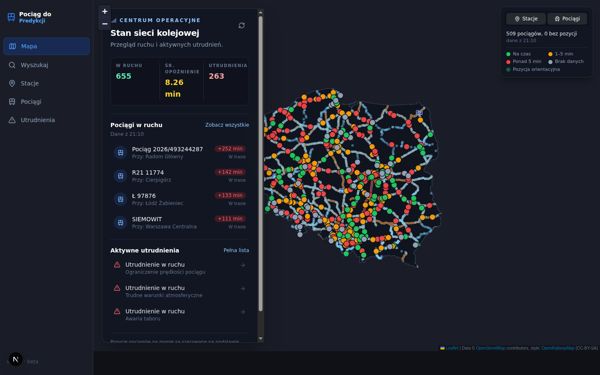
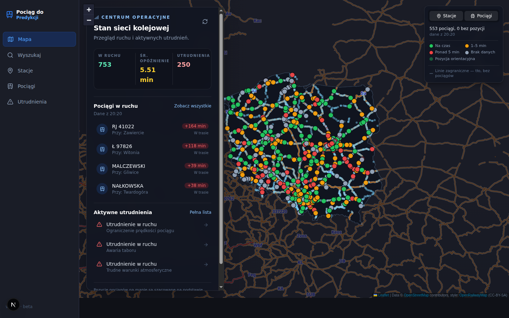
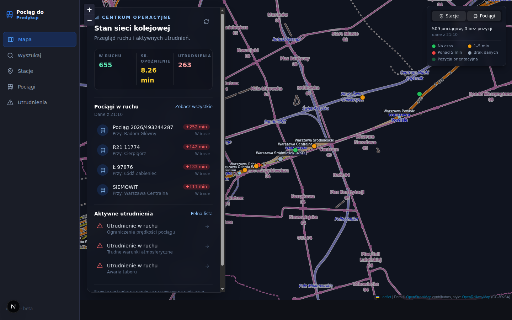
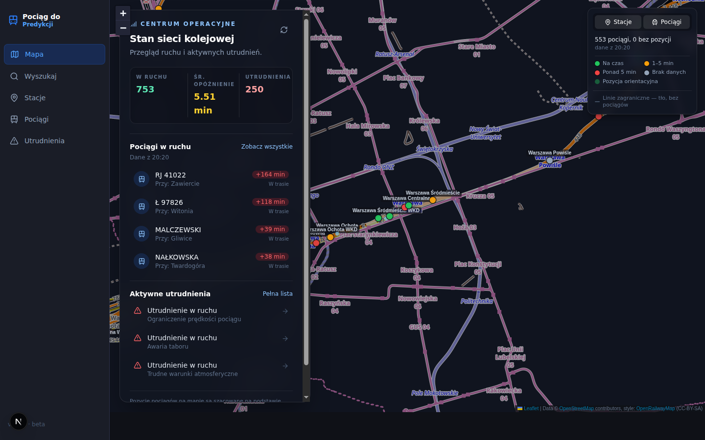
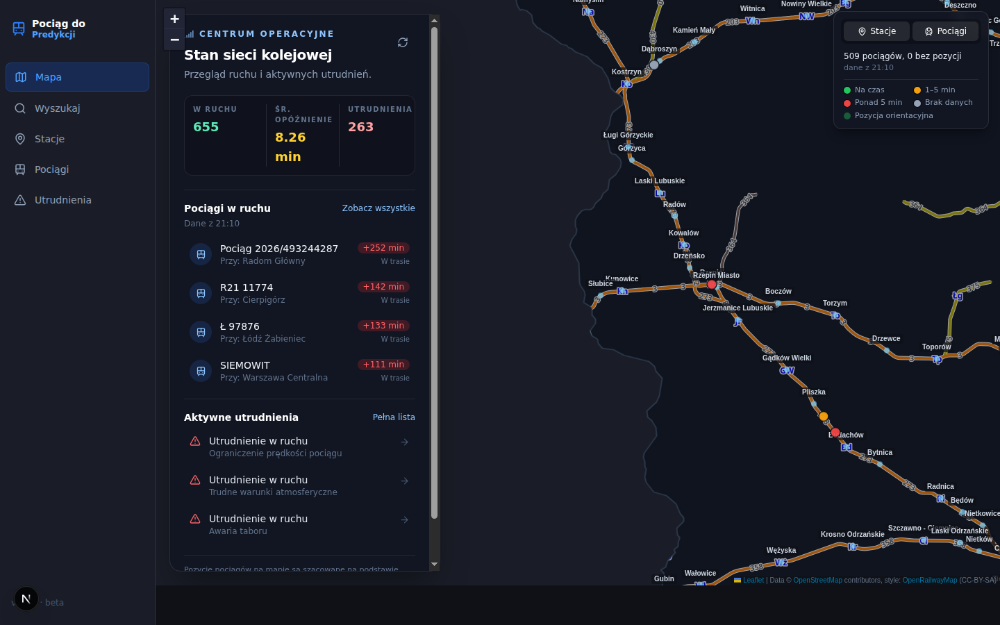
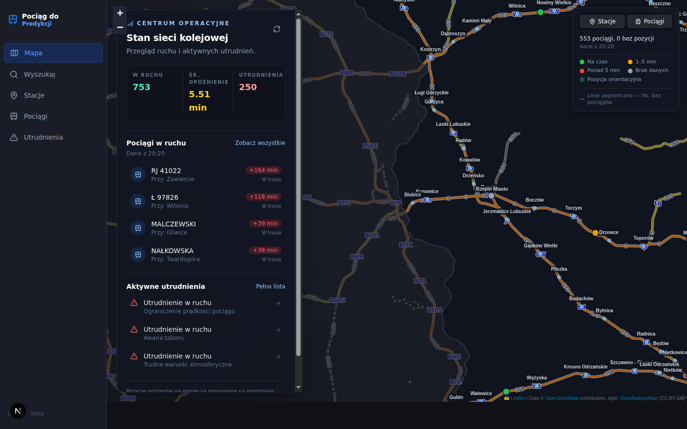

# /mapa: trains on railway lines + background map beyond Poland

Frontend-only change on branch `feature/fe-map-rail-snapping`. No API, spec or backend changes.

## Summary of changes

### Goal 1: trains snap to railway lines

| File | Change |
|---|---|
| `services/frontend/scripts/build-rail-lines.mjs` (new) | One-off generator: Overpass → simplified, topology-preserving GeoJSON of Polish railway lines |
| `services/frontend/public/poland-rail-lines.geojson` (new, generated) | 33,437 LineStrings, 99,178 vertices, 4.77 MB raw / 0.69 MB gzip, ODbL notice embedded |
| `services/frontend/src/lib/railSnap.ts` (new) | Pure functions: segment grid index, rail graph, nearest-segment snapping, A* routing between stops, on-screen overlap spreading |
| `services/frontend/src/lib/useRailSnap.ts` (new) | Hooks: `useRailIndex` (TanStack Query, caches the built index), `snapTrainPosition`, `useOverlapOffsets` |
| `services/frontend/src/components/TrafficMapClient.tsx` | `TrainsLayer` is now the single place a train's drawn position is decided; `estimatePosition` split into `segmentFraction` + `estimatePosition` |

### Goal 2: background map beyond Poland

All in `services/frontend/src/components/TrafficMapClient.tsx`:

- **Veil instead of mask:** the outside-Poland mask became a veil, `OUTSIDE_POLAND_STYLE.fillOpacity` 1 → 0.6. Foreign OpenRailwayMap tiles show through at ≈ 0.24 effective opacity, against 0.6 inside Poland, and the border stroke is kept.
- **Bounds and zoom:** `MAX_BOUNDS` goes from Poland + 15 % to Central Europe `[[45, 5], [58, 32]]`, and `minZoom` from 6 to 5. The initial view is still fitted to Poland.
- **Legend:** new row "Linie zagraniczne — tło, bez pociągów".

## How train positioning works

1. **Rail data.** The extract keeps `railway=rail` ways without a `service` tag, excluding `usage=industrial|military|tourism|test`. It also includes:
   - `service=crossover`, which links the two tracks of a double-track line;
   - `railway=construction` with `usage=main|branch`, because trains run today on lines that OSM still marks as under reconstruction (Krosno line 108, Wyszków line 29).

   Douglas–Peucker simplification runs at **15 m**. It never drops way endpoints or nodes shared by two or more ways, so junctions stay connected at identical 5-decimal coordinates.
2. **Index.** `buildRailIndex` runs once per session (≈ 120 ms) and builds:
   - a **0.05°** segment grid;
   - a routing graph (60.5k vertices) with connected-component labels;
   - a route cache (**2,000** entries).
3. **En-route trains** (both stops have coordinates):
   - Each stop is snapped to the graph within **`STATION_SNAP_MAX_METERS = 3000`**, preferring segments within **±45°** (`SNAP_HEADING_TOLERANCE_DEG`) of the stop-to-stop heading.
   - A* finds a route of at most max(**3×** the straight distance, straight + **20 km**), with at most **40,000** node visits.
   - The train is drawn at the wall-clock fraction *f* of its run along that route, not along the straight chord between stations.
   - Routes are cached per stop pair, so each 5 s tick costs only a binary search.
4. **Fallback** (no route, or a train not en route): the estimated or server position moves to the nearest segment within **`SNAP_MAX_METERS = 1500`**, again preferring the heading. With nothing in range, the raw position is kept.
5. **Right after a refetch:** fresh data is placed as of its fetch time, still on the route, so markers don't jump off their line for the 5 s until the next tick.

### Overlap strategy and why

Spreading markers perpendicular to the track (the first approach) moved them off their lines. At zoom 8, 9 px is about 5 km. The chosen strategy slides each overlapping marker **along its own track**, so it stays on its line:

- Active from **`OVERLAP_MIN_ZOOM = 8`**. Below that, in the country overview, markers may overlap.
- Iterative relaxation in screen space, at most **120** passes, towards a target spacing of **`OVERLAP_SPACING_PX = 8`** px between marker centres (markers have a 6.5 px radius). Only markers within the view padded by 20 % are considered.
- Ordering is deterministic: when a push is mostly sideways to the track (|cos| < **0.3**) or two markers coincide, the lower id moves back along the track and the higher id moves forward. This keeps markers from jittering between ticks.
- Route-following markers move along the **route polyline**, provided the result lands within **1.5 px** of the straight-line target. Markers without a bearing are pushed freely.
- Recomputed on every `moveend`, which also fires after each zoom.

## Before / after screenshots

All taken at 1440×900 with Playwright, using the same script and views (`setView` on the live Leaflet map).

| View | Before | After |
|---|---|---|
| Country (initial fit, z6) |  |  |
| Warszawa Centralna (52.2289, 21.0031, z14) |  |  |
| Border, Słubice / Frankfurt (Oder) (52.34, 14.55, z10) |  |  |

Since `maxBounds` no longer clamps the initial fit, the country view's centre moves slightly (19.13°E → 18.64°E) at the same zoom. Train counts differ between the shots because they show live data from different times.

## Test loop results

The checks ran with Playwright against the dev server, reading markers straight from Leaflet's layers:

1. **On the tracks:** share of trains within 25 m of a line, measured at z7, where spreading is off. Target ≥ 97 %.
2. **No pile-ups:** marker pairs closer than 5 px at Warszawa, Kraków Główny and Katowice, at z8, z11 and z14. Target 0.
3. **Smoothness:** long tasks during scripted pans and zooms around the border.
4. **Console:** no console errors.

| Iteration | Result | Action |
|---|---|---|
| 1 (after merging agents A and B) | **Fail.** 422/479 trains (88 %) on a line; about 55 trains more than 1.5 km off. Pile-ups at z8: 62 / 23 / 26 pairs (Warszawa / Kraków / Katowice) | Fixer: see the causes below |
| 2 | On the tracks 574/575 (99.8 %); 1 pair at Warszawa z8, intermittent; console clean | Re-sampled Warszawa z8 8× on a prod build: 0 pairs each time (closest pair 5.0–7.1 px) |
| 3 | **Pass.** 562/567 (99.1 %) on a line, 0 pairs in every view, console clean | Independent review, then fixes |
| 4 (after review fixes) | **Pass.** 554/557 (99.5 %), 0 pairs in every view, fresh load has 0 errors and 0 warnings | – |

The fixer in iteration 1 found three causes for trains off the line:
- **Coarse station coordinates from the API:** up to 3 km off, fixed by a 3 km station snap.
- **Double track split into separate OSM ways:** the tracks only connect through `service=crossover` ways, which the extract had dropped, so those are now included.
- **Lines that exist in OSM only as `railway=construction`:** these are now included for main and branch lines.

The fixer also replaced chord snapping with A* route-following, and replaced the perpendicular fan with along-track relaxation from z8.

**Performance:** both builds were measured as prod builds with the same pan/zoom script, 3 rounds each and both run orders.

| Build | Long tasks per round | Total | Max |
|---|---|---|---|
| `main` | 8–10 | ~1.25–1.40 s | ~450–520 ms |
| This branch | 2–6 | ~0.2–0.5 s | ≤ 176 ms |

Both builds draw the same 2,971 stations and 567 trains. The cause of the improvement wasn't investigated; the likely candidate is that `main`'s narrow `maxBounds` keeps forcing corrective re-pans near the border.

**Independent review findings:**

Fixed:
- After a refetch, trains briefly left their route.
- The index was rebuilt on every visit to `/mapa`; the query now caches the built index.
- The GeoJSON had no ODbL attribution or license keys.
- The A* heuristic was not admissible.
- Overlaps were recomputed twice per zoom.
- A function name in the generator header was wrong.

Not changed: see the limitations below.

## Known limitations and follow-ups

- **No foreign train positions.** The API has PLK trains only, so foreign countries get lines only (as tiles). Showing foreign trains needs a new data source and backend work.
- **Foreign layer styling:** at z5–6 the foreign network is still clearly visible. It is tunable through `OUTSIDE_POLAND_STYLE.fillOpacity`.
- **Off-line fallbacks (about 0.5–1 % of trains):**
  - Stops whose API coordinates are more than 3 km from a track, e.g. Lublin Zachodni. Filed as #58.
  - Stop pairs with no route within the detour bound (e.g. Warszawa Zachodnia↔Ochota, Bińcze→Biskupnica). These keep nearest-segment snapping within 1.5 km, so a marker can float on curvy lines.
- **Which track:** nearest-segment snapping, used for trains at a station and for fallbacks, can pick the wrong one of two parallel lines near junctions. Route-following trains are not affected.
- **Static extract:** regenerate it with `node scripts/build-rail-lines.mjs [toleranceMeters]` when the network changes. It needs Overpass, which is sometimes overloaded; the script retries with backoff and falls back to mirrors.
- **4.77 MB file:** fetched whenever trains are shown. It is served gzipped by `next start` (0.69 MB); a deployment behind another proxy must keep compression on.
- **OSM attribution:** the on-map OSM credit comes from the OpenRailwayMap tile layer. If that layer is ever removed, add an OSM/ODbL attribution for the rail extract.
- **Repo:** `services/frontend/src/lib/` is git-ignored by the root `.gitignore` `lib/` rule (#47, #55), so `railSnap.ts` and `useRailSnap.ts` must be committed with `git add -f`.
- **Unrelated finding:** `/favicon.ico` returns 404 (#57).
